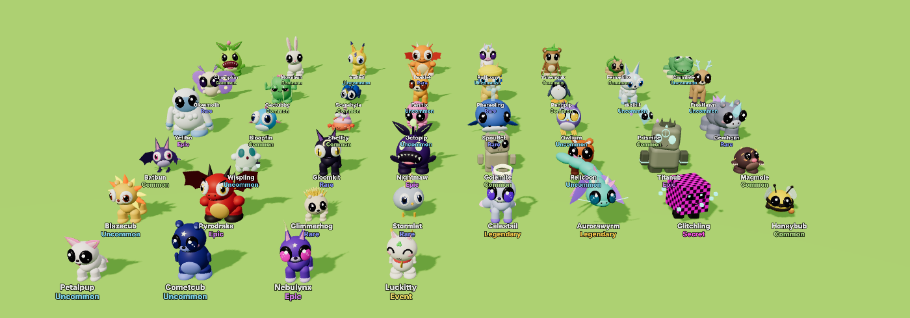
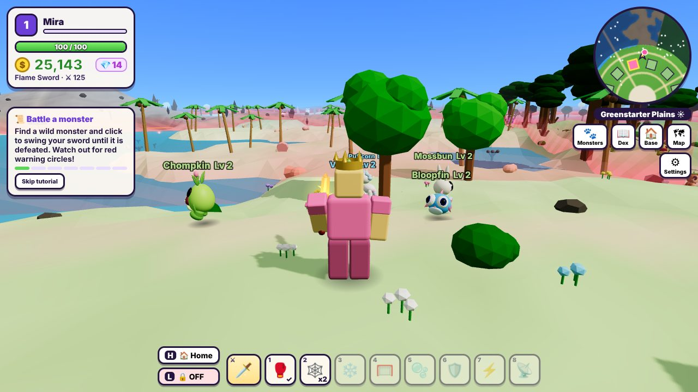
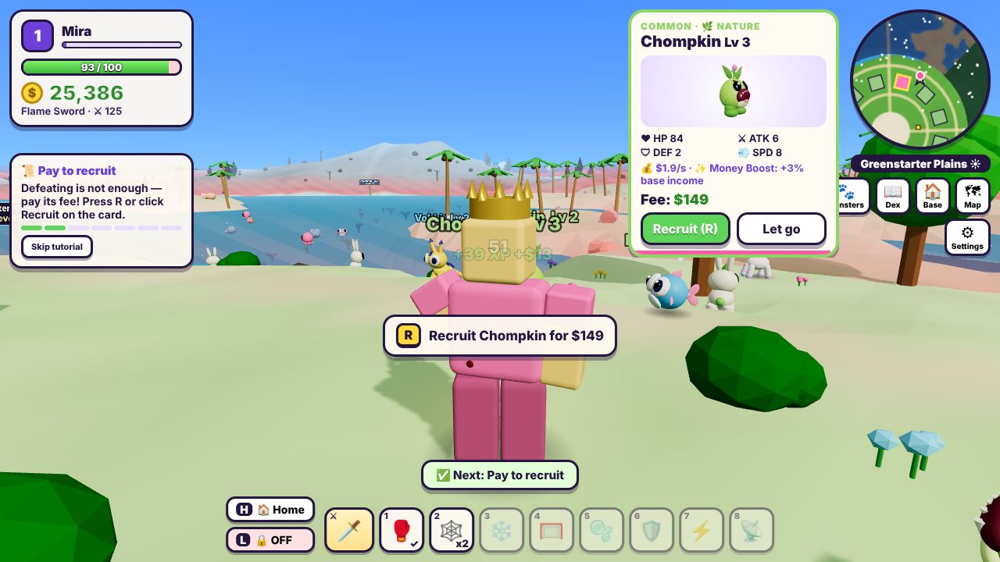
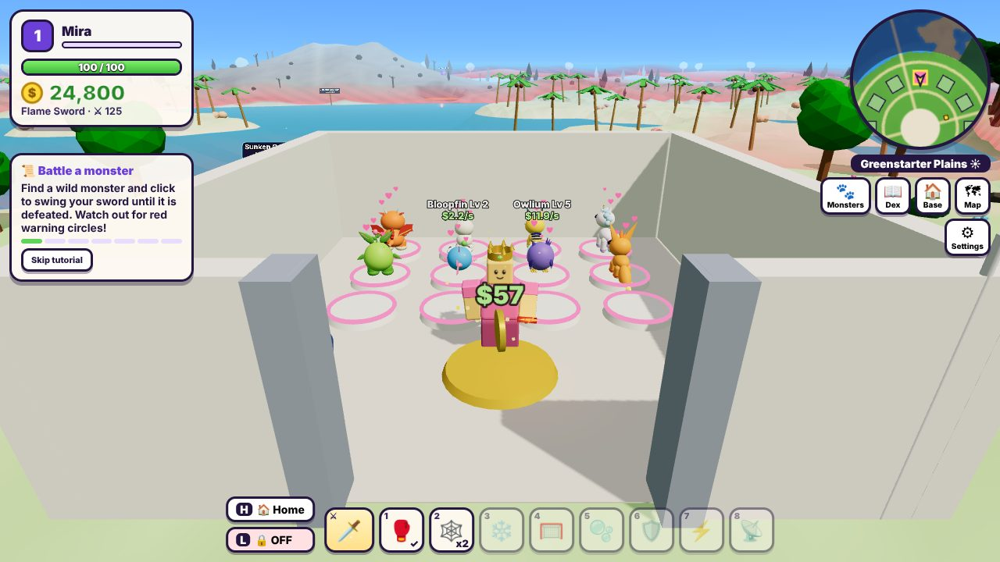
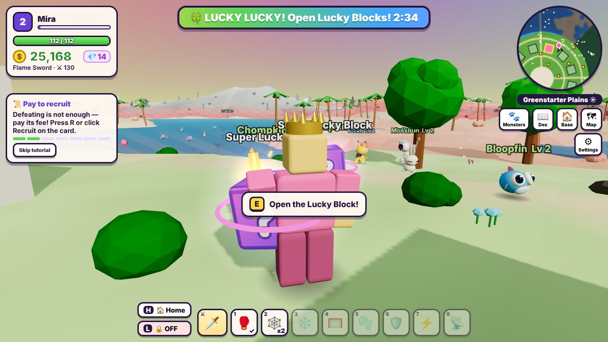
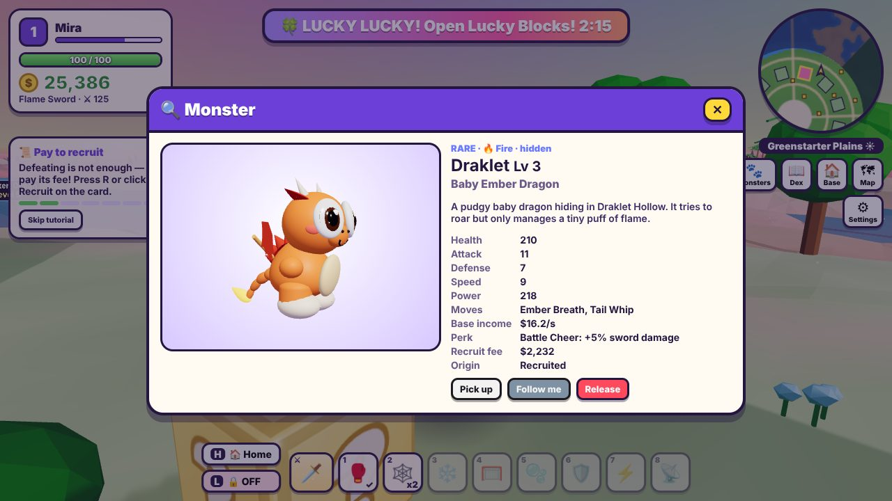
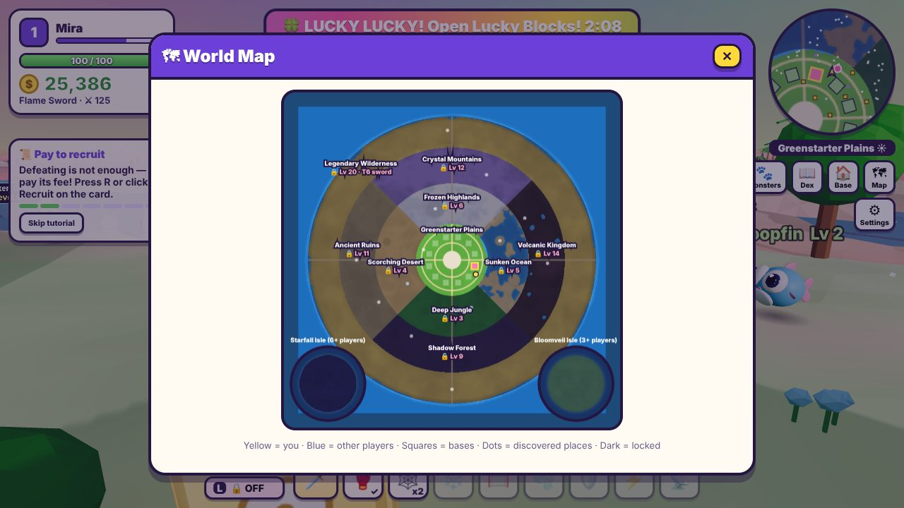
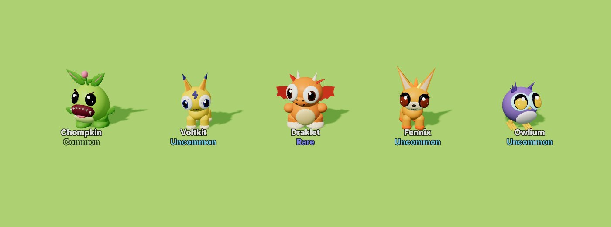

# STEAL A MONSTER

A 3D multiplayer browser game about **adorable baby monsters**. Explore a big
blocky world, battle wild monsters with your sword, **pay to recruit** the
ones you defeat, show them off in your base where they earn Money — and keep
rival players from walking in and stealing them.

Built from scratch with **Three.js** (client) and **Node.js + Express +
Socket.IO** (server). Not a Roblox game: no Roblox Studio, APIs or Luau.



**FIND → BATTLE → DEFEAT → PAY → RECRUIT → RETURN TO BASE → COLLECT → PROTECT (or STEAL)**

| | |
|---|---|
|  |  |
|  |  |
|  |  |



*Screenshots are from headless Chromium with software rendering
(`node scripts/screenshots.mjs`).*

---

## Play in the browser (no install)

**https://kenshirodaniel8-bit.github.io/minecraft-realistis/** — the
single-player web version. The whole game, including the game-server logic,
runs inside your browser; progress is saved in that browser. It is published
automatically to the `gh-pages` branch by `.github/workflows/steal-a-monster-pages.yml`
(build it yourself with `node scripts/build-web.mjs`, output in `dist-web/`).
If the link shows a 404, enable Pages once: repository **Settings → Pages →
Deploy from a branch → `gh-pages` / (root)**.

Multiplayer (stealing from other players, shared LUCKY LUCKY events) needs the
Node.js server below, hosted somewhere everyone can reach.

## Quick start (multiplayer server)

You need [Node.js](https://nodejs.org) 20 or newer.

```bash
cd steal-a-monster
npm install
npm start
```

Open **http://localhost:3000**, type a name, pick an outfit colour and press
**PLAY**. New players start with **1,000 Money**, a Wooden Sword, a Boing Glove,
two Sticky Traps and a base tower with room for 15 monsters. A short quest on the left
teaches the loop.

**Play with friends on the same Wi-Fi:** the terminal prints an address like
`http://192.168.1.20:3000` — open it on the other computers/phones.

**Several players on one computer:** open the game in a normal window *and* in
a private/incognito window (or another browser). Each browser profile keeps its
own player token, so each window is a different player. (Two tabs of the same
browser profile are the *same* player — the newest tab takes over.)

`npm run dev` restarts the server when server files change. The **Monster
Gallery** (`/gallery.html`, also linked on the title screen) shows every species
animated side by side.

---

## How to play

| Desktop | Action |
|---|---|
| **W A S D** / ↑ ↓ | Move (camera-relative); walking forward swings the camera behind you |
| **Drag** with the mouse (left or right button) · **← →** | Turn the camera · **V** toggles mouse-look (pointer lock) |
| Mouse wheel | Zoom |
| **Left click** (or **F**) | Swing your sword — it auto-aims at the nearest monster in front of you |
| **Space** | Jump / swim up · **Shift** run |
| **Q** | Dodge roll (brief invulnerability — dodge the red warning areas) |
| **E** | Interact: shops, Lucky Blocks, hold to steal, rescue a dropped monster |
| **R** | Recruit the defeated monster on your newest card (pays its fee) |
| **H** | Teleport to your base (20 s cooldown, not while carrying a stolen monster). Your base has a light beam and a "🏠 YOUR BASE" sign; when you're away, an on-screen 🏠 pointer shows the way and the distance |
| **L** | Switch on your base's security lasers (you must be at your base) |
| **1 – 8** | Use gadgets |
| **C** / Tab · **M** | Your monsters · World map |
| **T** / Enter | Chat · **Esc** close panels / settings · **F3** debug overlay |

**Phones and tablets:** joystick on the left, drag on the right half to look,
big ⚔ attack button, jump, dodge and **E** buttons; 🏠 home and 🔒 lasers at the
top; tap the hotbar for gadgets. Settings → *Touch controls* can force them on/off.

### The loop

1. **Explore.** The world is a ring of regions around the starter hub. The
   plaza in the middle has the **Sword Shop**, the **Gadget Shop**, the
   **Lucky Board** and the portals to the expansion islands. The 12 player bases
   ring the plaza. Every region (island) holds **50 wild monsters** while
   someone is on it — 57 species in all, each with its own 3D model.
2. **Battle.** Monsters roam their home territories. Some are shy and run, some
   ignore you until hit, territorial ones defend their home, aggressive ones
   chase you. Attacks are telegraphed with red areas on the ground.
3. **Defeat ≠ ownership.** A defeated monster sits dazed for 35 s and everyone
   who helped defeat it gets a **recruitment card** with its stats, perk, income
   and **fee**. The top fighter gets 12 s of priority. Pay the fee (R) to recruit
   it; if nobody does, it recovers and runs away. A few rare monsters add a
   **condition** shown on the card (for example owning a Tier 7 sword, or
   having discovered 20 species).
4. **Bring it home.** Recruited monsters follow you. Walk into your base (or press
   **H**) and they hop onto free pads automatically. Your base is a block tower:
   every floor has 10 pads, and the floors are joined by **stairs inside the
   tower** (there are no outside stairs, so a thief has to come in through your
   front door and lasers). Rearrange monsters, send one to follow you, or
   release one from the **Monsters** panel.
5. **Earn.** Every monster on a pad earns Money per second (rarer = more) and gives
   a **perk** (more income, speed, XP, max HP, regen, Lucky Block luck, recruit
   discounts, radar range, longer lasers or sword damage). Step on the gold **$**
   pad to collect. While you're offline your base keeps earning at half rate
   (up to 8 hours).
6. **Upgrade.** Better swords (16 swords in 11 tiers, from Wooden to Galaxy, many
   with a special: burn, chain lightning, bubbles that slow, freezing frost, a
   lucky jackpot, a rainbow combo, a star nova… — some need a
   level or a discovered region), more pads (15 → 25 → 35 → 45: each upgrade adds
   10, opening the next floor) and longer-lasting lasers.
   Levels come from XP and unlock new regions. The top swords and upgrades also
   cost **💎 Monster Gems**, the rare material: rare and stronger monsters drop
   them, the Volcanic Kingdom drops extra, **Gem Geodes** in the Volcanic Kingdom
   and Crystal Mountains are full of them, and Lucky Blocks sometimes give some.
7. **Decorate.** Buy decorations at your base (Base panel → Decorations): flower
   beds, lanterns, a bubble fountain, crystal clusters, a golden dragon statue…
   and place them on the 8 spots along your walls. Collection milestones award
   bronze, silver and gold **trophies**. Everyone who visits sees them.
8. **Protect or steal.** Your lasers stay on for 60 s (up to 120 s with
   upgrades), then switch off — come back and re-lock! When a rival's lasers are
   off you can walk in, **hold E** next to a monster and carry it home. Thieves
   are slower and can't teleport. Hit a thief with a gadget and they **drop** the
   monster; its owner can touch it to send it home, otherwise it flies home after
   9 s. If a thief reaches their own base, the monster is theirs.

### The world

| Region | Unlock | Highlights |
|---|---|---|
| Greenstarter Plains | start | Hub, bases, shops, Draklet Hollow (hidden cave), the Elder Oak |
| Deep Jungle | Lv 3 | Giant trees, Crumbite Pond, the hidden Whispering Clearing (night-only Glowmoth) |
| Scorching Desert | Lv 4 | Dunes, Mirage Oasis, the Sunken Chamber (Pharaoling) |
| Sunken Ocean | Lv 5 | Swim between islands, the Old Shipwreck, Coral Cove (Spoutlet) |
| Frozen Highlands | Lv 6 | Slippery Frostglass Lake, Yetibo Cave |
| Shadow Forest | Lv 9 | Glowing mushrooms, Moonlit Hollow (night-only Gloomkit & Nightmaw) |
| Ancient Ruins | Lv 11 | Pressure-plate puzzle that opens the vault of the guardian Titanub |
| Crystal Mountains | Lv 12 | Terraced cliffs, Geode Grotto (Gemhorn), Prism Peak |
| Volcanic Kingdom | Lv 14 | Lava pools (they burn!), the volcano crater lair of Pyrodrake |
| Legendary Wilderness | Lv 20 + Tier 6 sword | Celestail, the Aurora Wyrm nest, a secret glitchy something |
| Bloomveil Isle | 3+ players online, Lv 5 | Expansion island (portal in the plaza) |
| Starfall Isle | 6+ players online, Lv 15 | Expansion island |

There is a day/night cycle (12 minutes); some monsters only come out at night.
Entering a landmark or hidden place for the first time is a **discovery** with
a Money reward; the **Monsterdex** tracks every species you have met.

### Lucky Blocks and LUCKY LUCKY

Golden **?** blocks sit around every region — walk up and swing at one (or press
E). Rewards are rolled on the server: Money, XP, gadgets, new swords, hats,
recruit coupons, **clues** that reveal a rare monster on your map, or a surprise
**encounter** (still has to be defeated and paid for).

Every ~14 minutes the global **LUCKY LUCKY** event starts after a 10-second
countdown: the sky turns gold and rainbow, dozens of Lucky Blocks appear near
players, rare monsters spawn 3× as often and the event-only **Luckitty** roams.

### Gadgets (multiplayer items)

Boing Glove (knockback), Sticky Trap, Freeze Ray, Tangle Net, Slippery Gel,
Bubble Shield, Zoom Soda (speed) and Monster Radar. Gadgets only affect
players, have ranges and cooldowns checked by the server, and any hit on a thief
makes them drop the stolen monster.

---

## Multiplayer and deployment

`npm start` runs the web server **and** the real-time game server on one port.
Every important rule runs on the server; a static copy of the page alone cannot
play (there is no single-player fallback).

| Environment variable | Meaning | Default |
|---|---|---|
| `PORT` | Port to listen on | `3000` |
| `HOST` | Interface to bind | `0.0.0.0` |
| `DATA_DIR` | Where player saves go | `./data` |
| `MAX_PLAYERS` | Players per server (max 12 = number of base plots) | `12` |
| `EXPANSION_THRESHOLDS` | Players needed to open Bloomveil,Starfall | `3,6` |
| `LUCKY_EVENT_FIRST_MS` / `LUCKY_EVENT_INTERVAL_MS` | LUCKY LUCKY timing | 4 min / 14 min |
| `DEV_COMMANDS=1` | Enables `/lucky`, `/money N`, `/level N`, `/night`, `/day`, `/spawn <species>`, `/tp X Z` in chat | off |
| `NODE_ENV=production` | Longer browser caching | |

Example: `PORT=8080 DATA_DIR=/var/lib/steal-a-monster NODE_ENV=production npm start`.
On Windows PowerShell: `$env:PORT=8080; npm start`.

**Over the internet:**

- **A VPS / your own machine:** run `npm start` behind a reverse proxy (nginx,
  Caddy) that forwards WebSockets, or forward the port on your router. If the
  page is served over `https://`, Socket.IO automatically uses `wss://` on the
  same host.
- **Render, Railway, Fly.io and similar:** create a Node service in the
  `steal-a-monster` folder with build command `npm ci` and start command
  `npm start`. Use **one instance** (the game state lives in that process) and
  attach a persistent disk/volume mounted at `DATA_DIR`, otherwise saves are lost
  on every deploy.
- `GET /health` returns player/monster counts and save-failure counters for
  monitoring.

Stopping the server with Ctrl+C (SIGINT/SIGTERM) saves every online player first.

---

## Project structure

```
steal-a-monster/
  server.js                    entry point (env vars, graceful shutdown)
  server/
    network.js                 Express static server + Socket.IO wiring, /health
    game.js                    authoritative simulation: sessions, movement validation,
                               tick loop (20 Hz), snapshots (10 Hz), message dispatch
    storage.js                 JsonFileStore (atomic writes + .bak) and MemoryStore
    validate.js, rateLimit.js  input validation, per-message token buckets
    services/
      playerData.js            profiles: creation (1,000 Money once), schema migration,
                               sanitising, levels, perks, ownership ledger
      economy.js               Money, sword/gadget shops, upgrades, portals
      combat.js                sword hits, damage, dodge, player damage/death/respawn
      monsterAI.js             spawning (regions, hidden spots, night, events), AI states,
                               attacks with telegraphs, projectiles, interest snapshots
      recruitment.js           defeat -> offers -> pay -> ownership (idempotent)
      bases.js                 plots, placement, passive/offline income, collect, H key
      security.js              laser locks, intruder ejection
      stealing.js              grab/carry/deliver, interruption + drop rules, disconnects
      items.js                 gadgets and ground traps
      luckyBlocks.js           ambient/event blocks, claim + reward rolls
      events.js                LUCKY LUCKY lifecycle (generic event framework)
      worldExpansion.js        population tiers with hysteresis, region open/close
      puzzles.js               Ancient Ruins plate puzzle and sealed vault
  shared/                      identical on server and client
    config.js                  every gameplay number in one place
    regions.js, world.js       deterministic world: terrain, props, bases, caves, colliders
    monsters.js                the species registry (stats, AI, attacks, perks, model recipes)
    weapons.js, items.js, lucky.js, decor.js, collision.js, rng.js
  public/
    index.html, style.css, gallery.html
    client/
      main.js                  boot, connection, game loop, controls, interactions
      scene.js                 renderer, lights, sky shader, day/night, fog
      worldRenderer.js         terrain chunks, water, lava, instanced props, structures,
                               portals, region barriers, puzzle plates
      monsterRenderer.js       procedural monster models from recipes
      animationSystem.js       procedural animation for every rig (one central loop)
      monstersView.js          wild monsters: interpolation, labels, HP bars, telegraphs
      playersView.js           avatars, carried monster, companion follower, status FX
      basesView.js             pads, placed monsters, lasers, collector, signs, decorations
      decorModels.js           procedural 3D base decorations
      humanoid.js              blocky avatar, 10 procedural swords, 8 hats
      player.js, camera.js, input.js   movement prediction, third-person camera, controls
      ui.js, minimap.js, preview.js    HUD/panels, minimap + world map, monster previews
      effects.js, audio.js, net.js, labels.js, worldItems.js, gallery.js
  tests/                       node --test suites (see below)
  scripts/
    run-tests.mjs              npm test runner (works on Node 20+)
    e2e-smoke.mjs              two-player browser test (Playwright)
    load-test.mjs              12-player server load test
    ui-tour.mjs, mobile-check.mjs, screenshots.mjs   browser QA helpers
  TESTING.md                   what is tested automatically, by hand, and not at all
```

### Server authority

Clients send **intentions** ("I moved here", "I swung facing this way",
"recruit monster 42", "use gadget X facing Y"). The server owns positions of
monsters, all health values, damage rolls, cooldowns, Money, inventories,
ownership, base locks and events.

- **Movement** is predicted on the client for responsiveness and **validated**
  on the server: maximum speed (with tolerance for lag and knockback), height
  above ground, walls (a move through a base tower wall, a shop or a cave wall
  is refused, so the upper floors of a base can only be reached by its inside
  stairs), the world edge, locked regions, closed expansion islands, other
  players' locked bases and the sealed ruins vault. Invalid moves are snapped back.
  Teleports (H, portals, respawn) only go to server-chosen destinations and carry
  a sequence number so late packets can't undo them.
- **Combat:** the server picks targets from its own positions, applies sword
  range/arc/cooldown/max targets, rolls crits and specials, and broadcasts results.
- **Transactions** (recruit, purchases, upgrades) are synchronous on the server,
  carry a client request id and are answered from a cache on retry, so a network
  hiccup can never charge twice or grant twice.
- Every message is schema-checked and rate-limited; unknown messages are ignored;
  the client can't name prices, damage, rewards or coordinates.

### Persistence

Each player has a **versioned JSON profile** (`schemaVersion: 2`; older saves are
migrated on load — version 2 added Monster Gems and decorations) named after a
hash of a random secret token kept in the browser's localStorage (the token
itself is never stored on the server). Saves are written atomically (temp file →
fsync → keep previous as `.bak` → rename); a corrupt file falls back to the
backup, and if both are unreadable the login is **refused** instead of creating
a fresh profile. Profiles are saved every 5 s when changed and immediately after
any Money/ownership transaction; failed saves are retried. Loaded data is
sanitised (unknown species/swords/items dropped, duplicate ids and doubled pads
fixed, Money and Gems clamped, never more decorations placed than owned).

An **ownership ledger** (`data/ownership.json`, written before profiles on every
transfer) is the source of truth for who owns which monster, so a crash between
two profile writes during a theft can neither duplicate nor lose a monster.

> **Development storage.** The JSON store is meant for a single server process
> and moderate player counts. It is not a database: no multi-server access, no
> transactions spanning files, and the whole ledger is rewritten on change. For a
> real deployment implement the four methods of the store interface
> (`loadProfile`, `saveProfile`, `loadLedger`, `saveLedger` in
> `server/storage.js`) on PostgreSQL/SQLite/Redis — e.g. one row per player plus a
> `monster_owner` table updated in the same transaction as both profiles.

### Extending the game

- **A new monster:** add an entry to `SPECIES` in `shared/monsters.js` — stats,
  temperament, attacks (melee / lunge / projectile / slam / breath), perk, spawn
  rules (regions + weight, or a hidden `spot`, `time: 'night'`, events) and a model
  recipe (body shape, head, eyes/mouth styles, ears, horns, crest, wings, tail,
  legs, arms, back decorations, extras, aura). Check it at `/gallery.html?only=<id>`.
  Combat, AI, recruitment, bases, UI and tests pick it up automatically.
- **Swords / gadgets / Lucky rewards / cosmetics:** `shared/weapons.js`,
  `shared/items.js`, `shared/lucky.js`.
- **A region:** add it to `REGIONS` (shape, levels, unlock, `minPopulation`,
  terrain style, colours, props) and optional spots in `shared/world.js`; every
  region gets `CONFIG.monsters.perRegion` wild monsters.
- **An event:** add a definition to `EVENT_DEFS` in `server/services/events.js`
  (`onStart`, `onEnd`, `spawnTick`); the lifecycle and client sync are generic.
- **Balance:** `shared/config.js`.

### Assets

There are **no external asset files**. Monsters, players, swords, hats, props,
terrain, sky and particles are generated in code; sounds are synthesised with the
Web Audio API (`public/client/audio.js`). To use recorded sounds, call
`audio.setSample('<name>', url)` with the same names the game already plays
(`hit`, `coin`, `recruit`, `alarm`, ...). Hand-made glTF models could replace
`buildMonster()` per species, as long as they expose the same rig pivots
(`head`, `eyes`, `tail`, `legs`, ...) the animation system drives.

---

## Testing

```bash
npm test            # automated: node --test, 51 tests, runs in CI
npm run test:e2e    # two real browsers on one server (needs Playwright + Chromium)
npm run test:load   # 12 simulated players; reports server tick time and bandwidth
```

The automated suites run the real server code (with a controllable clock and an
in-memory or temporary-directory store) and, for networking, a real HTTP +
Socket.IO server with real socket clients. Requirement → test:

| # | Requirement | Test |
|---|---|---|
| 1 | New player gets exactly 1,000 Money | `profile.test.js` |
| 2 | Reconnect/refresh/respawn gives no second bonus | `profile.test.js` |
| 3, 4 | Two clients on one server, different bases, see each other move | `multiplayer.test.js` |
| 5 | Monsters have distinct real 3D models and working health | `combat.test.js` (builds all 57 models in Node) |
| 6 | Sword attacks apply valid damage (reach, facing, cooldown, no client damage) | `combat.test.js` |
| 7 | Monsters attack and can knock out players; respawn at own base | `combat.test.js` |
| 8 | Defeated monsters enter the recruitment state | `combat.test.js` |
| 9, 10, 11 | Recruit fails without Money / deducts exact price / never twice | `recruitment.test.js` |
| 12 | Placing on a free pad, one pad per monster | `recruitment.test.js` |
| 13 | Passive income rules, collecting, offline cap | `recruitment.test.js` |
| 14, 15 | Lasers block entry and theft / disabled lasers allow theft and transfer once | `stealing.test.js` |
| 16 | Interrupting a thief releases the monster (both drop rules) | `stealing.test.js` |
| 17 | H only to own base, cooldown, not while carrying | `stealing.test.js` |
| 18 | Gadget distance, facing, cooldown, shields, consumables | `stealing.test.js` |
| 19 | Lucky Blocks can't pay out twice | `world.test.js` |
| 20 | LUCKY LUCKY lifecycle and synchronisation between players | `world.test.js`, `multiplayer.test.js` |
| 21 | Regions open/close at population thresholds | `world.test.js` |
| 22 | Forged requests can't create Money/ownership/teleports | `world.test.js`, `multiplayer.test.js` |
| 23 | Progress survives a server restart (file storage) | `profile.test.js` |
| 24 | Disconnects during recruitment or theft keep ownership consistent | `recruitment.test.js`, `stealing.test.js` |

See **[TESTING.md](TESTING.md)** for what was verified by hand in a browser and
what remains unverified.

---

## Status and known limitations

The full loop is playable end to end in the browser and covered by automated
tests (see [TESTING.md](TESTING.md) for exactly what was and wasn't verified).
Known limitations:

- **Not verified on real hardware**: no real GPU, phone, Safari or Firefox was
  available while building this; frame rates on real devices are unmeasured.
- **Bases** are 5-floor towers with upgradeable pads (up to 45), lasers at the
  ground-floor door, income, a collector and 8 fixed ground-floor decoration
  spots; decorations can't be placed anywhere else, and they have no
  collision (you walk through them).
- **Movement** is predicted by the client and validated by the server (speed,
  terrain, walls, region locks, lasers); the server does not re-simulate every
  step. A cheater cannot teleport, pass walls or locked lasers, or create Money
  or monsters, but could move optimally within the speed limit.
- **Storage** is one JSON file per player (atomic writes + backups) in a single
  server process. That suits one world on one machine; a bigger deployment
  would swap in a database behind the same store interface.
- **Audio** is synthesized sound effects only (no recorded sounds or music).
- **Art** is entirely procedural (no imported models or textures).
- **Balance** (prices, income, spawn rates) has not been tuned by long playtests.

## Troubleshooting

- **"Cannot reach the game server"** — start it with `npm start` and open the
  address it prints (not the HTML file directly).
- **Black screen / very slow** — the game needs WebGL 2. Lower *Graphics* in
  Settings (Low disables shadows and shortens the view distance; it applies
  immediately, antialiasing after a reload). Press **F3** to see FPS and draw calls.
- **"Your saved progress could not be loaded"** — the profile file and its backup
  are both unreadable; nothing was overwritten. Look in `DATA_DIR/players/`.
- **Camera doesn't turn** — drag with the mouse, use the ← → keys, or press V
  (some embedded browsers block pointer lock).
- **Port in use** — `PORT=3001 npm start`.

## License

MIT
